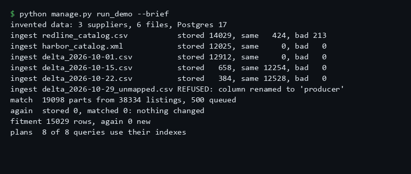
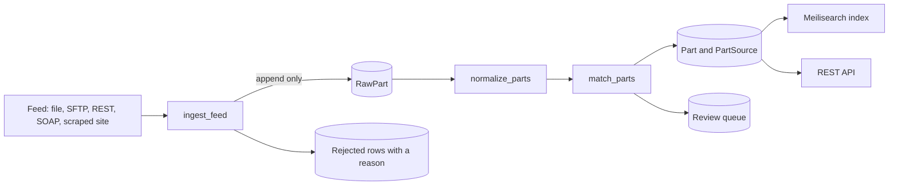

# Camlobe

[](https://github.com/Exalt24/camlobe/actions/workflows/ci.yml)



*Replayed from the real output of `python manage.py run_demo --brief` ([captured text](docs/demo-captured.txt)). Everything in it is invented data on a local database.*

A Django and PostgreSQL pipeline that ingests auto parts catalogs from several suppliers' feeds, normalises part numbers, matches the same part across suppliers without guessing, and serves the result through REST and a Meilisearch index.

On 20,000 invented parts, 40,008 stored feed rows from three suppliers became 19,098 parts, 14,106 of them listed by two or more suppliers. No part was merged wrongly or split against the generator's own truth file, and a second pass over every source wrote nothing ([run output](docs/test-runs/2026-10-25-run-demo-20k.txt)).

## What it is and why it exists

A parts distributor sends a catalog in whatever shape its export tool produces: the same part as `MF-H4123A`, `h 4123 a` or `0000451233`, a brand spelled four ways, a column that is renamed in the middle of the month, a file in two encodings. The pipeline has to keep what was received, turn it into one canonical catalog, and be safe to run again after a crash. This repository is that pipeline on data I made up, because no real supplier feed could be published.

Three invented suppliers, each with its own faults, feed one universe of parts:

| Supplier | Format | Faults on purpose |
|---|---|---|
| redline | CSV, windows-1252 | lines pasted as UTF-8, undefined bytes, exact duplicate rows, blank part numbers, `N/A` costs |
| harbor | XML | brand missing on some items, zero padded numbers, a renumbered part that reuses another part's barcode |
| delta | four CSV files with a BOM | columns reordered, two columns renamed to a known alias, then one renamed to something unknown |

## What it does



| Stage | Command | What is guaranteed |
|---|---|---|
| Ingest | `ingest_feed` | the raw row is stored as received and never changed (a trigger refuses UPDATE and DELETE); a second run over the same source changes nothing; a killed run resumes at its checkpoint; for a supplier flagged as sending its whole catalog, a part missing from a complete run is delisted ([feeds](docs/feeds.md#full-snapshots-and-delisting)) |
| Normalise | `normalize_parts` | one canonical number per row, with the rules that fired recorded ([rules](docs/normalization.md)) |
| Match | `match_parts` | the same brand and number across suppliers is one part; a row with no brand or with a conflicting barcode goes to a review queue instead of being merged ([rule](docs/matching.md)) |
| Index | `rebuild_search_index`, `sync_search_index` | the rebuild resumes and swaps in at the end; the sync sends only parts that changed |
| Serve | `runserver` | search, part detail with sources and fitment, vehicle fitment, run status ([API](docs/api.md)) |
| Orders | `edi_po`, `edi_parse` | an X12 850 built from a supplier's own part numbers, and readers for 855, 856 and 810 ([EDI](docs/edi.md)) |

Feed adapters (local file, SFTP, paged REST with rate limit and retry, SOAP, and an HTTP scraper for a site with a login) sit behind one interface: [feeds](docs/feeds.md). The scraper was tested against a local fake site only: see Limits.

## Measured

Windows 11 desktop, Docker Postgres 17 on localhost, one process. Counts and timings are from the saved runs below.

| Run | Raw rows | Parts | Listed by 2 or more suppliers | Review queue | Ingest per file | Normalise | Match |
|---|---|---|---|---|---|---|---|
| 20,000 parts ([output](docs/test-runs/2026-10-25-run-demo-20k.txt), same counts again after two fixes: [output](docs/test-runs/2026-10-26-run-demo-20k.txt), and after the review fixes below: [output](docs/test-runs/2026-10-26-run-demo-20k-after-review.txt)) | 40,008 | 19,098 | 14,106 | 500 | 1.1 to 2.0 s | 3.3 s | 11.0 s |
| 100,000 parts ([output](docs/test-runs/2026-10-25-run-demo-100k.txt)) | 199,886 | 95,345 | 70,468 | 2,518 | 5.2 to 11.4 s | 20.0 s | 65.7 s |

`python manage.py check_query_plans` runs `EXPLAIN ANALYZE` on the queries the pipeline and API depend on and fails when one stops using its index. At 20,000 parts the nine checked queries each took under 3 ms. It also found two real problems while it was being written: Django had generated a partial index on the barcode with a predicate Postgres could not use, and a second index on the part number duplicated the one that serves both equality and prefix search.

## What was hard

- **A search setting that hid new parts.** Turning typo tolerance off for part numbers only, per attribute, worked on the first build and made every part number added afterwards unfindable on Meilisearch 1.12.8. The sync test `test_a_part_added_after_the_build_is_found_by_its_number` caught it (commit 652e08a). Typo tolerance is now off for the whole index, which also costs typo tolerance on description words.
- **Rows re read after a gap.** A paged source whose page 2 fails keeps its checkpoint at the gap, so the pages after it are read again on the next run. The mutation harness showed that deleting the per row idempotency key guard left every test green. `test_rereading_rows_after_a_gap_does_not_store_a_row_twice` now pins it.
- **A mutation harness that edited nothing.** Two guards that span several lines in files with CRLF line endings were never edited, so their mutants were reported as survivors that were not real. The harness now matches on LF text and refuses to report a mutation that changed nothing.
- **A search that missed a quarter of the numbers a supplier prints.** A reviewer who had not seen the code sampled 400 supplier-written numbers from the generator's truth file and 125 found nothing on either backend: the query was normalised with no brand, so `DU-ZR7208` kept its prefix and a Kestrel number lost its real leading zero. A query is now tried in every form a supplier might print (as typed, with no brand, with each brand's rules), against both backends through one function, and the same 400 give 0 misses on both.
- **A guard that did nothing.** One mutant survived because the guard it removed was redundant with the line after it (`indexed_version` is set to the version that was sent, so a part edited mid send stays behind anyway). The dead condition was removed and a mutant for the real defect was added.

## Run it

No account or key is needed. Docker, Python 3.13 and Git Bash on Windows 11 are what it was run with.

```bash
docker compose up -d                       # Postgres 17 on 5434, Meilisearch on 7701
python -m venv .venv && . .venv/Scripts/activate    # macOS or Linux: . .venv/bin/activate
pip install -r requirements-dev.txt
python manage.py migrate
python manage.py run_demo                  # about 30 s: generate, ingest, match, fitment, plans, index, then again
```

`run_demo` needs an empty database and prints every stage with its timing, ending in a summary that matches the first table above. The macOS and Linux activate line and the `docker compose` commands outside Windows were not run here.

Then `python manage.py runserver` and, for example, `curl "localhost:8000/api/parts/search/?q=h-4123%20a"`.

## Tests

```bash
python -m pytest tests/ -o addopts=""      # 954 tests, needs Postgres on 5434 and Meilisearch on 7701
python tools/mutation_check.py             # 296 guards, edits source in place: run it in a copy (--help)
```

The database tests use the compose Postgres and create their own `test_camlobe` database. The search tests skip when Meilisearch is down, and CI starts both.

- 954 tests, all passing in a run on 2026-10-26 after the second scraper output round ([output](docs/test-runs/2026-10-26-pytest-after-second-round.txt)); 686 passed after the first ([output](docs/test-runs/2026-10-26-pytest-after-output-round.txt)), 597 after the second review ([output](docs/test-runs/2026-10-26-pytest-after-review.txt)), 442 earlier that day ([output](docs/test-runs/2026-10-26-pytest.txt)) and 435 on 2026-10-25 ([output](docs/test-runs/2026-10-25-pytest.txt)).
- Every rule has a test in both directions: the case that must match and the near miss that must not. Part numbers and the X12 reader also have Hypothesis properties.
- Seeded random worlds (`tests/test_pipeline_simulation.py`): 24 worlds are run clean and again with injected failures in every stage, and the two end states must be identical by content.
- A real process is killed mid ingest (`test_a_process_killed_mid_run_leaves_a_consistent_checkpoint_and_the_rerun_finishes`) and the rerun finishes the file.
- Mutation harness: 296 guards. On 2026-10-25 all 144 then in the harness were killed ([output](docs/test-runs/2026-10-25-mutation.txt)), after ten survivors in the first passes that each ended as a new test, a removed redundant guard or a fix to the harness. After the second review all 234 were killed ([output](docs/test-runs/2026-10-26-mutation-after-review.txt)), and after the first scraper output round 115 of 115 new or touched ones ([output](docs/test-runs/2026-10-26-mutation-output-round.txt)). Most guards since then have their edit derived from the syntax tree by `tools/mutate_ast.py` (in the repository), not matched as text. After the second output round all 295 guards then in the harness were run in a copy of the repository and killed in 1,822 s ([output](docs/test-runs/2026-10-26-mutation-second-round-295.txt)); the guard added after that run and the one it changed were killed in a second run. Two guards are weaker than the rest: the one for the rel token only empties the default selector, and the SOCKS one is a text pair on `requirements.txt`, which `mutate_ast.py` cannot edit.

## Register: what ran and what did not

| Ran here | Not run |
|---|---|
| Postgres 17 and Meilisearch 1.12.8 in Docker on Windows 11 | any real supplier, any real feed |
| an SFTP server (paramiko) running inside the test process | a real SFTP server, key based login |
| local fake REST and SOAP servers (zeep against a WSDL I wrote) | a real REST API or SOAP service, WS-Security, cursor pagination |
| invented X12 documents, read back by my own reader | any trading partner, VAN or EDI translator |
| the data generator's truth file as the oracle for matching | real part numbers, real ACES or VCdb reference data |
| 200,000 rows on one machine | millions of rows, several workers at once (only the advisory lock is tested) |
| the CI workflow file | a run of that workflow on GitHub: the repository has not been pushed |
| a local fake shop site (login with a CSRF token, expiring session, rate limit, challenge page) and a local forwarding proxy, for the scraper | any real site, a real proxy service, a real bot challenge or web firewall |
| nothing is deployed | Linux and macOS |

## Limits

- **HTTP scraping is built, and was only ever run against a local fake site.** It has never met a real site, a real proxy service, a real CAPTCHA or a web firewall, and a real site's login, markup and limits will differ. It checks robots.txt, spaces its requests, honours Retry-After and stops on a block or a challenge without trying to get past it, and a page the site cut short, an empty table or a body shorter than announced ends the run as partial and never as a success, but none of that is permission: use it only on a site whose owner has allowed it, with its terms read ([feeds](docs/feeds.md#scraping-a-site)).
- **Known limits of the scraper, not fixed:** `rowspan` in a product table; a price cell with two bare whole amounts split by one space and no currency sign (`12 345` reads as one price, `$20 $15` is refused); and a SOCKS proxy was only tried against a refused connection, never a working one.
- A delisting rests on one snapshot per supplier: a supplier that sends two full feeds at once (brakes in one file, filters in another) must not be flagged, and a feed that is truncated but reads cleanly is only caught when it would delist more than half the listings.
- A page repeated whole by a paged source is detected, pages that overlap are not. A resumed REST or SOAP run starts at the page of its checkpoint, so it needs the API to keep its order between two runs (the scraper never resumes by position): [feeds](docs/feeds.md#paged-sources).
- A secret in a URL parameter whose name does not say so (`?k=...`) stays in the stored source name, because hiding every query value would merge two sources into one checkpoint; it is taken out of every message ([feeds](docs/feeds.md#secrets)).
- Search on the database backend does not fold accents and Meilisearch does.
- **Known limit, not fixed:** if an index rebuild crashes between the swap and the deletion of the staging index and is then resumed, the old index can be put back live, and the sync cannot repair it (it only sends parts whose version is behind). The cure is `rebuild_search_index --restart`.
- Fitment is a small invented table in ACES style (year, make, model, submodel, engine, position). It is not the VCdb.
- The brands, aliases, prefixes and zero rules are invented. The structure is realistic, the content is not any manufacturer's.
- The part number rules remove every dot and slash, which loses information in a catalog where those are meaningful. A change to the rules does not re match old rows.
- Matching never fuzzes a number: a typo and a renumbered part both appear as a new part or a review item.
- No typo tolerance in search, for numbers or for words.
- The API has no authentication and is read only. Costs are USD cents only.
- The REST adapter expects offset pagination and `{"items"}` with an optional `"total"`. The SOAP adapter expects a `GetCatalogPage(offset, limit)` operation.
- The X12 reader is a stated subset, not tested against any partner ([EDI](docs/edi.md)).
- The mark in `brand/` is not independently reviewed, and the trademark search for the name has not been run ([brand file](brand/BRAND.md)).

## Stack

Python 3.13, Django 5.2, Django REST framework, PostgreSQL 17, Meilisearch, paramiko, zeep, requests with SOCKS support, defusedxml, beautifulsoup4 with lxml, pytest and Hypothesis, Docker Compose, GitHub Actions.

## License

MIT, see [LICENSE](LICENSE).
